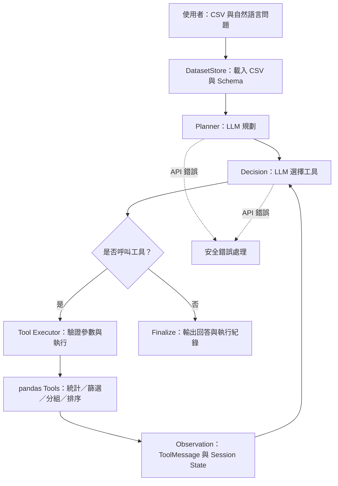

# 智慧資料分析 Agent（Data Analysis Agent）

本專案以 **Python、LangGraph、LLM Function Calling 與 pandas** 建立可執行的 CSV 資料分析 Agent。使用者提供 CSV 與自然語言問題，系統便規劃分析步驟、呼叫受控工具進行計算、根據工具回傳結果決定後續動作，並輸出繁體中文分析說明。除遠端 LLM 服務外，系統可使用 **Podman** 容器執行。

## 1. 系統架構



- **LLM Provider：** 預設 OpenAI `gpt-5.4-mini`，可透過環境變數切換 Gemini；LLM 負責語意理解、規劃、工具選擇與說明，**不應自行計算資料數值**。
- **LangGraph：** `planner → agent → execute_tools → agent → ... → finalize`，並使用 State 保存訊息、計畫、狀態和執行紀錄。
- **DatasetStore：** 在單次執行中保管原始資料與中間 DataFrame；工具以 `source_id`（初始為 `dataset`）和 `result_id` 串接。原始 CSV 檔案不會被修改。
- **Tool Executor：** 僅執行五個白名單工具；工具輸入由 Pydantic 定義，數值計算由 pandas 完成。
- **Trace：** 可選擇將 Plan、Decision、Tool Arguments、Observation、錯誤與耗時保存為 JSON；預設不保存 API Key 或 SDK 原始例外訊息。

更多元件與資料流說明見 [`documents/HW2_ARCHITECTURE.md`](documents/HW2_ARCHITECTURE.md)。

## 2. 功能與工具

| Tool | 功能 | 主要參數 |
|---|---|---|
| `inspect_dataset` | 欄位、資料型態、資料筆數、缺失值與樣本 | `source_id` |
| `calculate_statistics` | 總和、平均、最小、最大、非空值數量 | `column`, `operation`, `source_id` |
| `filter_data` | 等值、比較或文字包含篩選 | `column`, `operator`, `value`, `source_id` |
| `group_and_aggregate` | 依一至三個欄位分組統計 | `group_columns`, `metric`, `operation`, `source_id` |
| `sort_and_rank` | 升降冪排序，取得前 N 筆 | `column`, `direction`, `top_n`, `source_id` |

`filter_data`、`group_and_aggregate` 與 `sort_and_rank` 會產生可供後續工具使用的 `result_id`。完整參數、回傳格式與錯誤碼見 [`documents/HW2_TOOL_CATALOG.md`](documents/HW2_TOOL_CATALOG.md)。

**目前範圍：** 單份 UTF-8 CSV、單次互動分析、受控資料操作與多步驟 Tool Calling；不包含長期記憶、RAG、跨檔案 Join、異常值偵測或圖表產生。最終自然語言回答仍由 LLM 生成，**流程狀態 `completed` 不代表已自動逐字或逐數值驗證答案**；評估時應以獨立計算結果比對。

## 3. 系統需求

- Python **3.12 或 3.13**（容器使用 Python 3.12）。
- 有網路連線、可使用且具額度的 OpenAI API Key（需自行負擔 API 使用費用）；`--inspect-only` 與離線測試不需要 API。
- Windows：PowerShell / VS Code；容器部署使用 Podman 與可正常啟動的 WSL2 Podman Machine。
- 其他支援 Podman 的作業系統可依相同 `podman build` / `podman run` 原則使用。

## 4. 安裝與環境設定

在專案根目錄（含 `Containerfile` 和 `requirements.txt` 的資料夾）執行。

**Windows PowerShell：**

```powershell
py -3.13 -m venv .venv
.\.venv\Scripts\python.exe -m pip install -r requirements-dev.txt
Copy-Item .env.example .env
```

若只有 Python 3.12，第一行改為 `py -3.12 -m venv .venv`。正式環境僅需 `requirements.txt`；開發測試使用 `requirements-dev.txt`。

**macOS / Linux：**

```bash
python3 -m venv .venv
.venv/bin/python -m pip install -r requirements-dev.txt
cp .env.example .env
```

開啟 `.env`，填入自己的金鑰（**不要公開或提交此檔**）：

```dotenv
LLM_PROVIDER=openai
LLM_MODEL=gpt-5.4-mini
OPENAI_API_KEY=replace_with_your_openai_api_key
MAX_TOOL_CALLS=8
LLM_TIMEOUT_SECONDS=120
LLM_MAX_RETRIES=2
LLM_RETRY_BASE_SECONDS=1.5
```

參數說明：`MAX_TOOL_CALLS` 為一次分析允許的工具呼叫上限；`LLM_MAX_RETRIES=2` 表示暫時性 LLM 錯誤最多額外重試兩次（總計三次嘗試）。401/403/429 等錯誤預設不自動重試。若改用 Gemini，可設定 `LLM_PROVIDER=gemini`、對應有效的 `LLM_MODEL` 與 `GOOGLE_API_KEY`；模型可用性與額度以供應商為準。

## 5. 執行方式

以下 Windows 範例均由專案根目錄執行。

**A. 離線檢查 CSV（不用 API）：**

```powershell
.\.venv\Scripts\python.exe -m src.main --csv data/sample_sales.csv --inspect-only
```

預期顯示 `row_count: 14`、`column_count: 5`，並列出 `OrderID`、`Category`、`Region`、`Revenue`、`Quantity` 的型態與缺失值。

**B. 自然語言資料分析：**

```powershell
.\.venv\Scripts\python.exe -m src.main --csv data/sample_sales.csv --question "找出總營收最高的商品類別，並說明該類別在哪個地區營收最高。" --trace-file logs/analysis_trace.json
```

這份範例 CSV 的獨立 pandas 正確答案為：最高營收商品類別 **Tech = 6,000**；Tech 營收最高地區 **North = 2,800**。模型可以選擇不同的合理工具路徑，最後的主要數值仍應相符。

**C. 檢查 Trace（離線）：**

```powershell
.\.venv\Scripts\python.exe scripts/trace_report.py logs/analysis_trace.json
.\.venv\Scripts\python.exe scripts/audit_trace.py logs/analysis_trace.json
```

第一個腳本摘要顯示各階段耗時與工具結果；第二個檢查中間結果代號的引用順序與計數一致性。**來源稽核通過不等於回答的全部自然語言敘述都經驗證。**

## 6. Podman 容器部署

先確認 `podman --version`、`podman machine list` 與 `podman info` 可正常執行（Windows 上需要先啟動 Machine）。

**建立映像與離線檢查：**

```powershell
podman build -t data-analysis-agent:hw2 -f Containerfile .
podman run --rm data-analysis-agent:hw2 --csv data/sample_sales.csv --inspect-only
```

**執行容器中的 OpenAI Agent 並將 Trace 保存到 Windows：**

```powershell
New-Item -ItemType Directory -Force .\logs | Out-Null
podman run --rm --env-file .env -v "${PWD}/logs:/app/logs" data-analysis-agent:hw2 --csv data/sample_sales.csv --question "找出總營收最高的商品類別，並說明該類別在哪個地區營收最高。" --trace-file logs/openai_podman_trace.json
```

`--env-file .env` 在執行時注入環境變數，**不會將金鑰寫入 Image**；`-v` 將本機 `logs/` 掛載到容器的 `/app/logs`，使刪除容器後仍能讀取 Trace。若 Windows / WSL 掛載權限不足，可不使用 `--rm`、改用 `podman cp`：

```powershell
podman run --name hw2-evidence --env-file .env data-analysis-agent:hw2 --csv data/sample_sales.csv --question "哪個商品類別營收最高？" --trace-file logs/evidence_trace.json
podman cp hw2-evidence:/app/logs/evidence_trace.json .\logs\evidence_trace.json
podman rm hw2-evidence
```

如果曾建立同名容器，請先用 `podman ps -a` 檢查並適當清除。上述 `podman run` 回傳非零狀態碼時，仍可嘗試複製其 Trace。

## 7. 測試與驗證

**完整 pytest（不會向 OpenAI 發送請求）：**

```powershell
.\.venv\Scripts\python.exe -m pytest -q
```

**產生兩個可重現的失敗案例證據（不需 API Key）：**

```powershell
.\.venv\Scripts\python.exe scripts/failure_cases.py
```

- **F01 — 欄位不存在：** 計算 `Money` 平均值，工具回報 `COLUMN_NOT_FOUND`。
- **F02 — 型態不符：** 計算文字欄位 `Category` 平均值，工具回報 `TYPE_MISMATCH`。

這兩個案例由 **ScriptedLLM 預先指定模型回應**，但執行正式 LangGraph 與 pandas Tools；不應宣稱這是 GPT 自主做出的錯誤選擇。證據會保存至 `documents/evidence/failure_cases/`；正式 OpenAI 成功案例見 `documents/evidence/success_case/`。測試分層、評估方式及限制見 [`documents/HW2_TEST_PLAN.md`](documents/HW2_TEST_PLAN.md)。

**使用 Podman 執行離線測試：**

```powershell
podman build -t data-analysis-agent:hw2 -f Containerfile .
podman build -t data-analysis-agent:hw2-test -f Containerfile.test .
podman run --rm data-analysis-agent:hw2-test
```

## 8. 錯誤處理與注意事項

- CSV 格式、欄位或型態不合法時，顯示 `DataToolError` 對應錯誤碼；工具錯誤以 `ok=false` 的 `ToolMessage` 回傳，供 Agent 決策或要求澄清。
- API 呼叫的常見 5xx、逾時及暫時性網路問題採有限重試；401、403、429、400、404 不盲目重試。各嘗試階段與安全診斷碼會寫入 Trace。
- CSV 檔案上限預設 **15 MiB、100,000 列、100 欄**；單次最多保留 **30 個**中間結果，避免過度消耗資源。
- Trace 可能包含使用者提問、欄位樣本與工具結果；公開 GitHub 只能提交經檢查的模擬資料證據，不要提交私人資料或直接複製未審核的 `logs/`。
- 原始 CSV 不會被寫回；系統不允許 LLM 執行任意 Python、Shell、SQL 或自行下載資料。
- LLM 決策可能漏掉某些子目標；完整性與最終答案仍需以獨立 Ground Truth 評估，不能把 `completed` 誤解為「所有子任務與數值已經過自動驗證」。

詳見 [`documents/HW2_ARCHITECTURE.md`](documents/HW2_ARCHITECTURE.md)、[`documents/HW2_TOOL_CATALOG.md`](documents/HW2_TOOL_CATALOG.md)、[`documents/HW2_TEST_PLAN.md`](documents/HW2_TEST_PLAN.md)。
