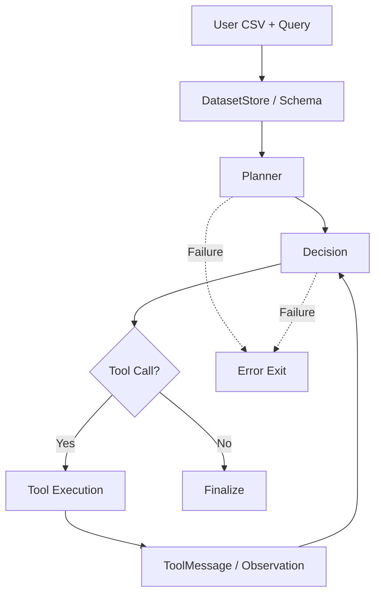

# Data Analysis Agent — 系統架構與技術設計

## 1. 目標與輸入輸出

本系統將自然語言的 CSV 資料分析需求轉換為可執行的、可追蹤的 pandas 操作。輸入是 **UTF-8 CSV 檔案**和**自然語言分析問題**；輸出為分析結論、工具執行統計，以及可選的 JSON Trace。數值運算不由 LLM 直接執行。

## 2. 元件職責

| 元件 | 程式位置 | 責任 |
|---|---|---|
| CLI | `src/main.py`, `src/cli.py` | 引數處理、執行入口、顯示結果、寫 Trace |
| Config | `src/config.py` | 驗證 Provider、模型、重試及工具限制 |
| LLM Provider | `src/llm/factory.py` | 建立 ChatOpenAI／ChatGoogleGenerativeAI；不包含業務邏輯 |
| Reliability | `src/llm/reliability.py` | LLM 錯誤碼分類、限制重試次數、逐次計時 |
| StateGraph | `src/agent/graph.py` | Planner、Decision、Tool Executor、Finalize 及條件路由 |
| Prompts | `src/agent/prompts.py` | 規劃與工具使用規則，不允許任意程式執行 |
| State | `src/agent/state.py` | 問題、Schema、計畫、訊息、執行統計與 Trace |
| Tool Registry | `src/agent/tools.py` | 五個 Pydantic StructuredTool 輸入定義 |
| DatasetStore | `src/data/store.py` | 讀取 CSV、Schema、保存單次分析的中間結果 |
| Data Operations | `src/data/operations.py` | pandas 決定性統計、篩選、分組與排序 |

## 3. Workflow 與決策



1. **載入**：DatasetStore 以 pandas 解析 CSV，擷取欄位、型態、資料量、缺失值與少量樣本。原始檔案不修改。
2. **Planner**：LLM 擬定不含推算數字的步驟計畫，記入 `plan` 與 Trace。
3. **Decision**：LLM 基於問題、目前計畫、Schema 與先前 ToolMessage 決定下一個 Tool Call（同一輪可呼叫多個工具），或回覆。
4. **Execute Tools**：對工具與輸入參數進行結構化驗證，在 Python 進行真正的 pandas 運算；以 `ok=true/false` 包裝觀測結果。
5. **Observation → Decision**：每個 Tool Result 以匹配 `tool_call_id` 的 ToolMessage 回到 LangGraph State，下一輪由 LLM 決定是否繼續。
6. **Finalize**：有成功工具結果和可讀取的模型回答時，輸出 `completed`；無可用工具結果時回報未驗證或錯誤。`completed` 僅是流程狀態，並非逐個答案數值的自動證明。

## 4. 工具資料流與 Result ID

原始資料的 `source_id` 固定為 `dataset`。篩選、分組或排序會將新 DataFrame 暫存於 `DatasetStore`，以 `result_001`、`result_002` 等代號供後續工具引用。

例如：

```text
group_and_aggregate(source_id="dataset", group_columns=["Category"], metric="Revenue", operation="sum")
    -> result_id="result_001", result_column="Revenue_sum"
sort_and_rank(source_id="result_001", column="Revenue_sum", direction="desc", top_n=1)
    -> result_id="result_002", rows=[{"Category":"Tech", "Revenue_sum":6000}]
```

工具不接受未註冊的來源 ID，LLM 也不得執行任意 Python／Shell。資料存放於程式記憶體中；**不提供跨執行的持久化 Checkpoint**。中間結果上限 30 份，避免無限制累積。

## 5. 狀態與 Trace

`AgentState` 保存 `user_query`, `schema`, `plan`, `messages`, `trace`, `tool_executions`, `successful_tools`, `failed_tools`, `status`, `answer` 等資訊。對話訊息使用 LangGraph `add_messages` reducer，保留原生 Tool Call ID 與供應商必要的訊息中繼資料。

Trace 主要事件：`llm_call`、`plan`、`decision`、`observation`、`error`、`final`。工具觀測紀錄包含工具名稱、參數、結果和耗時；資料來源可用 `scripts/audit_trace.py` 進行基本引用稽核。

為便於除錯，部分工具輸出會附帶少量資料樣本；因此 Trace **可能含有資料內容**。程式不會刻意加入 API Key 或原始 SDK 例外字串，仍須由使用者在分享前審核資料。

## 6. 錯誤處理與限制

- CSV 載入的欄位錯誤、資料格式錯誤由 `DataToolError` 顯示一致錯誤碼。
- 工具的參數驗證失敗、來源不存在、欄位型態不符或空結果，會以 ToolMessage 回饋 Agent。
- API 5xx、逾時與暫時性連線問題可以有限重試；429、401/403 等情況預設停止。
- `MAX_TOOL_CALLS` 限制工具執行次數，避免無限制迴圈。
- 遇到多個語意相近欄位時，Prompt 要求模型向使用者確認；目前沒有獨立的語意對應確信度模組。
- 即使工具結果正確，LLM 仍可能產生不完整、缺少依據的自然語言答案；本版沒有通用的回答數值逐項核對器，應用外部 Ground Truth 評估。

## 7. 容器部署

`Containerfile` 使用 Python 3.12 slim，安裝 runtime 相依套件，複製 `src/` 與 `data/`，以非 root 使用者執行 CLI。使用 `--env-file .env` 在 **執行時**傳入 API Key，避免將密鑰寫進 Image。使用 `-v "${PWD}/logs:/app/logs"` 可將 Trace 保存到主機。`Containerfile.test` 基於已建置的 `data-analysis-agent:hw2` Image，添加 pytest 執行離線測試。

詳細指令見根目錄 `README.md`。
